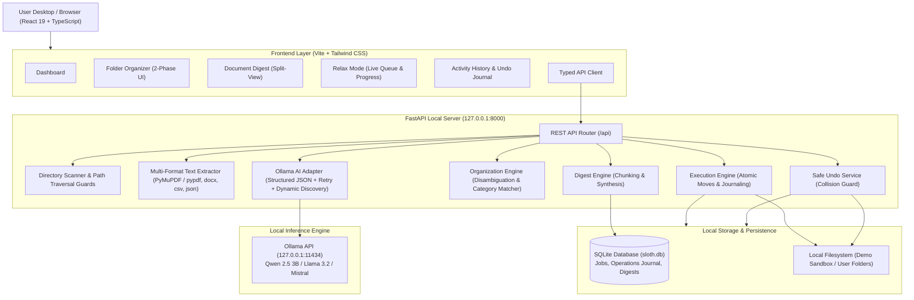

# SLOTH — Architecture & System Design

**Hacktoberfest 2026 | “Slow and Steady” | Local-First Open-Source AI**

SLOTH is designed with a strict **local-first, privacy-by-default architecture**. It pairs locally hosted open-weight LLMs (via Ollama) with deterministic filesystem safeguards, ensuring that file operations are transparent, safe, and reversible.

---

## 1. High-Level System Architecture



---

## 2. Core Subsystems

### A. Dedicated Ollama Local AI Adapter (`backend/app/services/ai_service.py`)
- **Direct Local Inference:** Communicates over HTTP with `http://127.0.0.1:11434`.
- **Dynamic Model Auto-Discovery:** Queries `/api/tags` to discover which models are already pulled (e.g. `qwen2.5:3b`, `llama3.2:3b`, `mistral:latest`), defaulting gracefully to the active model.
- **Strict JSON Enforcement:** Prompts specify strict JSON schemas (`format="json"`, temperature 0.2).
- **Graceful Fallback & Truth in AI:** If Ollama is offline, the application switches to deterministic rule-based heuristics and explicitly tags suggestions as `is_ai_generated: false` with `[Rule-Based Heuristic (Ollama Offline)]`. Hardcoded or simulated outputs are never disguised as AI inference.

### B. Safe Directory Scanner (`backend/app/services/scanner.py`)
- **Path Traversal Protection:** Validates that target paths exist, are directories, and do not reference root drives (`C:\`, `/`) or Windows system folders (`System32`, `Program Files`).
- **Symlink Safeguards:** Inspects and validates symlink targets before discovery; broken or escaping symlinks are rejected.
- **Noise Filtering:** Automatically filters `.git`, `node_modules`, `__pycache__`, `.venv`, `.DS_Store`, and temporary thumbs.

### C. Multi-Format Text Extractor (`backend/app/services/extractor.py`)
- **PDF Extraction:** Extracts page-bounded selectable text using `pypdf` / `pymupdf`. Gracefully identifies scanned or image-only documents and instructs the user that OCR is required.
- **DOCX Extraction:** Reads paragraphs, headings, and tabular cells via `python-docx`.
- **Structured Data:** Parses CSV headers and sample rows; formats JSON structures; reads UTF-8 plain text and markdown.
- **Media & Binaries:** Extracts metadata (dimensions, file size, extensions) for media files without attempting corrupted text reads.

### D. Two-Phase Organization Pipeline (`backend/app/services/organizer.py` & `executor.py`)
1. **Phase 1 — Analysis & Plan Preview:**
   - AI proposes a clean human-readable filename, category, subcategory, reason, and tags.
   - Deterministic backend sanitizes illegal filesystem characters (`<>:"/\|?*`).
   - Collision detection auto-disambiguates identical target paths using incremental numbering (e.g., `Notes (1).pdf`).
   - The user reviews, inline-edits, or excludes any item before approval.
2. **Phase 2 — Explicit Execution & Journaling:**
   - Filesystem modifications require explicit user approval.
   - The source and destination are re-validated immediately before the move.
   - Operations are journaled to SQLite before and after execution.

### E. Safe Reversible Undo (`backend/app/services/undo_service.py`)
- Uses the `operations` table journal.
- Checks whether the target file still exists.
- Validates that the original path is vacant before moving the file back, preventing accidental overwrites.
- Marks the operation as `undone` in SQLite.

---

## 3. Database Schema (SQLite)

```sql
-- Jobs audit table
CREATE TABLE jobs (
    id TEXT PRIMARY KEY,
    job_type TEXT NOT NULL,
    target_path TEXT,
    status TEXT NOT NULL,
    total_items INTEGER DEFAULT 0,
    processed_items INTEGER DEFAULT 0,
    error_message TEXT,
    metadata_json TEXT,
    created_at TEXT NOT NULL,
    completed_at TEXT
);

-- Durable operations journal
CREATE TABLE operations (
    id TEXT PRIMARY KEY,
    job_id TEXT,
    action_type TEXT NOT NULL,
    original_path TEXT NOT NULL,
    destination_path TEXT NOT NULL,
    status TEXT NOT NULL,
    error TEXT,
    executed_at TEXT,
    undone_at TEXT,
    metadata_json TEXT,
    FOREIGN KEY (job_id) REFERENCES jobs(id)
);

-- Persisted document digests
CREATE TABLE document_digests (
    id TEXT PRIMARY KEY,
    file_name TEXT NOT NULL,
    file_path TEXT NOT NULL,
    file_size INTEGER DEFAULT 0,
    summary_length TEXT NOT NULL,
    executive_summary TEXT NOT NULL,
    key_takeaways TEXT NOT NULL,
    action_items TEXT NOT NULL,
    deadlines TEXT NOT NULL,
    important_concepts TEXT NOT NULL,
    questions TEXT NOT NULL,
    category TEXT NOT NULL,
    extracted_preview TEXT,
    is_ai_generated INTEGER DEFAULT 1,
    model_name TEXT,
    created_at TEXT NOT NULL
);
```
